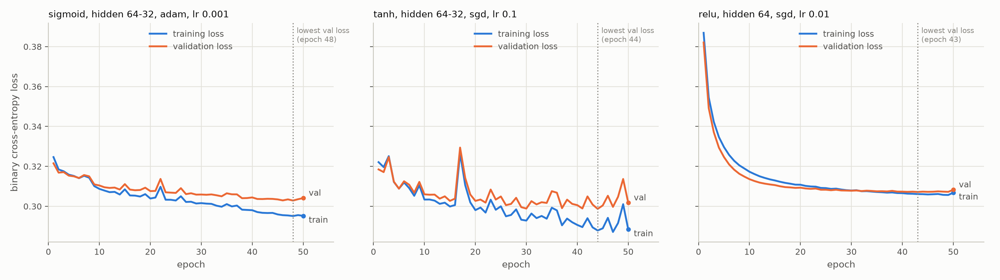
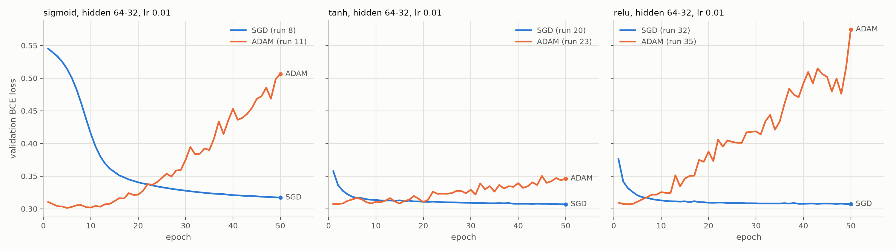

# Feed-Forward Neural Network from Scratch — UCI Adult (Census Income)

A feed-forward neural network with one or two hidden layers. The forward pass, backpropagation and the optimizers are written by hand in NumPy, with no PyTorch, TensorFlow, autograd or similar. It is trained to predict whether a person earns more than $50K a year.

## Dataset

- **UCI Adult / Census Income:** https://archive.ics.uci.edu/dataset/20/census+income
- The code downloads `adult.data` and `adult.test` from the public UCI URL (`https://archive.ics.uci.edu/ml/machine-learning-databases/adult/`) every time it runs, so the data is not included in this repo.
- The two files are merged into 48,842 rows, with 12 features after dropping two columns (91 inputs after one-hot encoding; see Assumptions).
- This is a binary task: `>50K` is labelled 1 and `<=50K` is labelled 0.
- The classes are imbalanced, with about 23.9% positive, so macro-F1 is reported alongside accuracy.
- **Split:** stratified **70 / 15 / 15** (train / validation / test), giving 34,188 / 7,327 / 7,327 rows.
- **Random seed:** 42 (set with `--seed`). It controls the split, weight initialization and mini-batch shuffling, and every result in this repo was produced with it.

## Installation

Requires Python 3.x (developed with Python 3.13) and an internet connection to download the data.

```bash
pip install -r requirements.txt
```

On macOS and some Linux systems the commands are `python3` and `pip3`. Use those wherever this README says `python` and `pip`.

Optionally, install into a virtual environment:

```bash
python -m venv .venv
source .venv/bin/activate          # Windows: .venv\Scripts\activate
pip install -r requirements.txt
```

## Reproduce the best result

The best configuration, chosen on validation accuracy, is run 10: sigmoid, two hidden layers (64, 32), Adam, learning rate 0.001.

```bash
python train.py --hidden 64 32 --activation sigmoid --optimizer adam --lr 0.001 --epochs 50 --batch-size 64 --seed 42 --test
```

Expected output: validation accuracy **0.8583**, test accuracy **0.8601**, test macro-F1 **0.7898**. Two runs of the same command give identical numbers.

## Run everything

Run these from the repository root, in this order. All outputs go to `results/`.

```bash
python gradient_check.py        # 1. check backprop against numerical gradients (a few seconds)
python run_experiments.py       # 2. run the 36-configuration sweep and write the results table (~3 min)
python final_evaluation.py      # 3. learning curves, test results for the best runs, baseline (~30 s)
```

### 1. Gradient check

`gradient_check.py` compares the backprop gradients with finite-difference estimates for every activation, with 1 and 2 hidden layers. It prints the largest relative error for each case, then `PASS` (all errors are about 1e-8 or less).

### 2. Single run: `train.py`

```bash
python train.py                                   # defaults: --hidden 64, relu, adam, lr 0.001
python train.py --hidden 64 32 --activation tanh --optimizer sgd --lr 0.01
python train.py --hidden 64 32 --test --save results/run.json
```

The script prints the configuration it is using, including the seed, then a log line per epoch with train/val loss and accuracy. At the end it prints accuracy, macro-F1 and loss.

| Flag | Default | Meaning |
|---|---|---|
| `--hidden` | `64` | Neurons per hidden layer, 1 or 2 values (e.g. `--hidden 64 32`) |
| `--activation` | `relu` | Hidden activation: `sigmoid`, `tanh` or `relu` |
| `--optimizer` | `adam` | `sgd` (plain mini-batch gradient descent) or `adam` |
| `--lr` | `0.001` | Learning rate |
| `--epochs` | `50` | Number of training epochs |
| `--batch-size` | `64` | Mini-batch size |
| `--beta1` / `--beta2` / `--eps` | `0.9` / `0.999` / `1e-8` | Adam settings (SGD ignores them) |
| `--threshold` | `0.5` | Predict `>50K` when the predicted probability is at least this |
| `--seed` | `42` | Random seed for the split, weight initialization and shuffling |
| `--split` | `0.70 0.15 0.15` | Train / validation / test ratios |
| `--test` | off | Also evaluate on the test set. Use this only for final configurations. |
| `--save PATH` | — | Write the config, per-epoch history and metrics to a JSON file |
| `--quiet` | off | Turn off the per-epoch log |

### 3. Experiment sweep: `run_experiments.py`

```bash
python run_experiments.py                         # optional: --config experiments.json --out results --verbose
```

The hyperparameters for the sweep are in the config file `experiments.json`, which has two parts:
- `defaults` holds the settings every run shares: 50 epochs, batch size 64, Adam settings, threshold 0.5, seed 42 and the 70/15/15 split.
- `grid` holds lists of values. Every combination becomes one configuration: 3 activations × 2 architectures (`[64]`, `[64, 32]`) × 2 optimizers (SGD, Adam) × 3 learning rates (0.001, 0.01, 0.1) = **36 runs**.

Before training, the script checks that the grid meets requirement 5 of the assignment. The data is downloaded and split once, and every run uses the same split. Only training and validation data are used.

| Output | Contents |
|---|---|
| `results/results.md`, `results/results.csv` | **The results table**: one row per configuration with its parameters, train/val accuracy, train/val macro-F1, final train/val loss, the epoch with the lowest validation loss, and training time. All metrics are from the final (50th) epoch. |
| `results/runs/<id>_<activation>_<hidden>_<optimizer>_lr<lr>.json` | One file per run with its config, per-epoch history and metrics, plus the `train.py` command that reproduces that run on its own |

### 4. Final evaluation: `final_evaluation.py`

```bash
python final_evaluation.py   # optional: --baseline-C 1.0 --baseline-max-iter 1000 --target-acc 0.85 --compare-hidden 64 32 --compare-lr 0.01
```

1. For each activation, picks the best configuration from `results/results.csv` using validation data only.
2. Plots the learning curves from the saved histories.
3. Retrains the three best configurations with the same seed and evaluates them on the test set. The script checks that each retrained model matches its saved validation accuracy exactly.
4. Trains a logistic regression baseline (scikit-learn) on the same split, with the same preprocessed features and the same decision threshold.

This is the only script that uses the test set.

| Flag | Default | Meaning |
|---|---|---|
| `--results` | `results` | Folder written by `run_experiments.py` |
| `--baseline-C` | `1.0` | Logistic regression inverse regularization strength |
| `--baseline-max-iter` | `1000` | Logistic regression solver iterations |
| `--target-acc` | `0.85` | Validation accuracy used to measure convergence speed in the optimizer comparison |
| `--compare-hidden` | `64 32` | Architecture shown in the SGD vs Adam plot |
| `--compare-lr` | `0.01` | Learning rate shown in the SGD vs Adam plot |

| Output | Contents |
|---|---|
| `results/final.md`, `results/final.csv` | Train/val/test accuracy and test macro-F1 for the best run per activation and for logistic regression, with the command that reproduces each row |
| `results/plots/learning_curve_<activation>.png` | **Learning curves**: training and validation loss vs epoch on the same axes, for the best run of each activation. A dotted line marks the epoch with the lowest validation loss. |
| `results/plots/learning_curves.png` | The three learning curves side by side, with the same y-axis |
| `results/plots/sgd_vs_adam.png` | Validation loss of SGD vs Adam for each activation, at the architecture and learning rate set by `--compare-hidden` / `--compare-lr`. Only the optimizer differs between the two lines. |
| `results/optimizer_comparison.csv` | For every matched SGD/Adam pair: the first epoch reaching `--target-acc` validation accuracy, the lowest validation loss and the epoch it happened, and final validation accuracy and macro-F1 |

## Results

Full table of all 36 configurations: [`results/results.md`](results/results.md).

Best configuration per activation (chosen on validation accuracy) and the logistic regression baseline, on the test set (from [`results/final.md`](results/final.md)):

| Model | Configuration | Train acc | Val acc | Test acc | Test macro-F1 |
|---|---|---|---|---|---|
| **Sigmoid (run 10), best overall** | [64, 32], Adam, lr 0.001 | 0.8617 | **0.8583** | 0.8601 | 0.7898 |
| Tanh (run 21) | [64, 32], SGD, lr 0.1 | 0.8665 | 0.8581 | 0.8649 | 0.8029 |
| ReLU (run 26) | [64], SGD, lr 0.01 | 0.8576 | 0.8561 | 0.8567 | 0.7843 |
| Logistic regression | C = 1, max_iter 1000 | 0.8531 | 0.8534 | 0.8491 | 0.7778 |
| Always predict `<=50K` | — | — | — | 0.7607 | — |

Learning curves for the best configuration of each activation:



SGD vs Adam (validation loss, same activation, architecture and learning rate):



The report answering questions (a)–(d) is submitted separately as a PDF.

## Project structure

| File | Contents |
|---|---|
| `data.py` | Downloads and merges the raw files, cleans the labels, and makes the stratified train/val/test split |
| `neural_net.py` | The `NeuralNetwork` class (`preprocess`, `train`, `predict`, `evaluate`), the activations, and the `SGD` / `Adam` optimizers |
| `gradient_check.py` | Checks backprop's gradients against finite-difference estimates |
| `train.py` | Command-line script that trains and evaluates one configuration |
| `experiments.json` | The experiment sweep config: shared defaults plus a grid of values to combine |
| `run_experiments.py` | Runs every configuration in the sweep and writes the results table |
| `final_evaluation.py` | Learning curves, the SGD vs Adam comparison, test results for the best run per activation, and the logistic regression baseline |
| `requirements.txt` | Python dependencies |
| `results/` | All generated tables and plots |

## Implementation summary

- **Preprocessing (`NeuralNetwork.preprocess`):**
  - Missing values (`?`) in categorical columns become their own `Unknown` category. A median imputer covers numeric columns, although Adult has no missing numeric values.
  - Categorical features are one-hot encoded.
  - Numeric features are standardized.
  - Every transformer is fit on the training set only and then applied to validation and test.
- **Network:**
  - 1 or 2 hidden layers of any size, and every hidden and output neuron has a bias.
  - Hidden activation is one of `sigmoid`, `tanh` or `relu`.
  - The output is a single sigmoid unit trained with binary cross-entropy, whatever the hidden activation. The loss is computed from the output logit, which avoids overflow.
- **Initialization:** Xavier/Glorot (normal, Var = 2 / (fan_in + fan_out)) for sigmoid and tanh layers, He (normal, Var = 2 / fan_in) for ReLU layers. The sigmoid output layer always uses Xavier, and biases start at zero.
- **Backpropagation:** written by hand. For a sigmoid output with BCE the output gradient is (ŷ − y) / m. Each layer then computes dW = Aᵀ·dZ and db = Σ dZ, and passes dZ · Wᵀ ⊙ f′(Z) back to the previous layer.
- **Optimizers:** plain mini-batch SGD, and Adam with bias correction.
- **Vectorization:** each mini-batch is processed as one matrix per layer, with no Python loop over examples or neurons. The only loops are over epochs, mini-batches, layers and parameter arrays.

## Assumptions

- `adult.data` and `adult.test` are merged and then re-split 70/15/15 (stratified), instead of using the official test file as the test set.
- Missing values are kept as an `Unknown` category; no rows are dropped.
- `fnlwgt` is dropped because it is a census sampling weight, not a trait of the person. `education` is dropped because it duplicates `education-num` one-to-one.
- Duplicate rows in the raw data are kept.
- Xavier and He initialization use their normal-distribution versions. The output layer always uses Xavier because it is a sigmoid unit.
- A predicted probability of 0.5 or more is classified as `>50K` (`--threshold`). The logistic regression baseline uses the same threshold.
- Every run trains for a fixed 50 epochs with no early stopping, and the reported metrics are from the last epoch.
- The "best" configuration is the one with the highest validation accuracy, with validation macro-F1 breaking ties. The assignment says to use the validation set for tuning and names accuracy as the reported metric; macro-F1 is reported alongside it. The test set is used only for the best configuration of each activation and for the baseline.
- All results come from a single seed (42).
